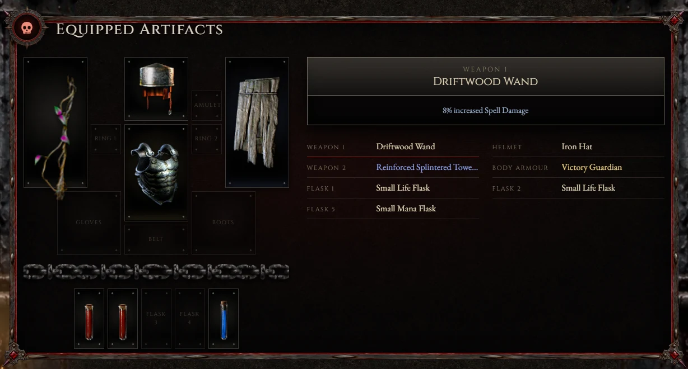
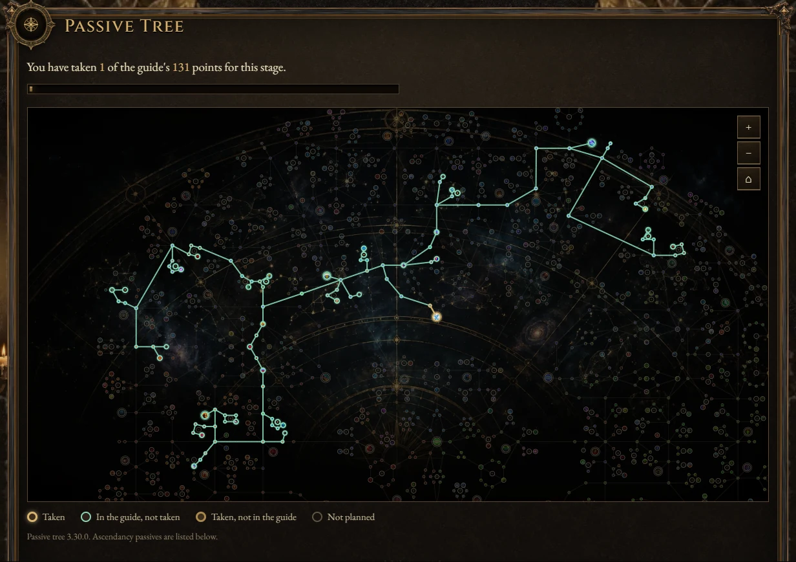
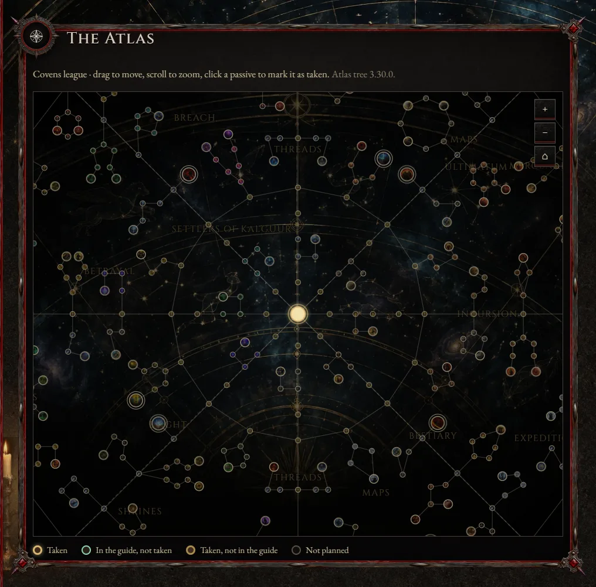

<p align="center">
  
</p>

<h1 align="center">Path of Building for Humans</h1>

<p align="center">
  <em>Same builds. A deeper understanding.</em>
</p>

<p align="center">
  A build planning companion for Path of Exile focused on clarity, guidance and actionable recommendations.
</p>

---

## Why this exists

[Path of Building](https://pathofbuilding.community/) is an incredibly powerful tool. It tracks every damage
multiplier, every defensive layer and every interaction in a build, and the community could not theorycraft
without it.

But it speaks the language of spreadsheets. It tells you **what the numbers are**, not **what they mean** or
**what to do next**. A new or returning player can open a build and see hundreds of stats, tabs and toggles,
and still not know:

- Is my build actually good?
- What is wrong with it?
- What single change would help the most?

Path of Building has the power. It lacks the human touch.

**Path of Building for Humans** keeps the same builds and turns them into answers: a clear verdict, the
problems that matter, and the next upgrade worth chasing.

## The 10-second rule

The dashboard is the first screen every player sees. It must answer three questions within ten seconds:

1. **How strong is my build?** An overall build score from 1 to 10, plus core metrics (DPS, EHP).
2. **What is wrong with my build?** Detected issues, ranked by severity, with their expected impact.
3. **What should I improve next?** The single highest-impact upgrade, with its estimated gain.

## Screenshots

**The armoury.** Your gear as on the in-game inventory, read out like the game's tooltip.



**Following a guide.** Your passive tree against the guide's: taken in gold, still to take in verdigris.



**The Atlas.** The Atlas passive tree over the star atlas, with each passive's icon from your own game.



## Features

| Feature | Status |
|---|---|
| Connect a public pathofexile.com profile and pick a character | v0.2.0 |
| Character dashboard calculated by Path of Building: Atlas Rating, DPS, EHP | v0.2.0 |
| Scholar's Verdict and Threat Register with level-aware rules | v0.2.0 |
| Refresh when you change zone (reads the game's `Client.txt`) | v0.2.0 |
| Guides from PoB codes, pobb.in or pastebin links, with stages (Maxroll-style) | v0.2.0 |
| Recommended Artifact: guide items ranked by measured DPS/EHP gain | v0.2.0 |
| Passive tree and gem comparison against the guide | v0.2.0 |
| Passive tree map with the game's own icons, compared with the guide | v0.3.0 |
| Atlas passive tree drawn over the star atlas, with progress against a guide's Atlas link | v0.3.0 |
| Desktop app with a custom title bar (Windows portable) | v0.1 |
| Single-file portable app, published as a GitHub Release | v0.3.0 |
| League meta and prices (poe.ninja) | Planned |
| Official OAuth account connection | Planned |
| Build snapshots and history | Planned |

## Visual identity: the Atlas Archivist

The application is not a game UI, and it is not a SaaS dashboard. It is an **Atlas research tool**: an exiled
scholar studying character builds through ancient codices, celestial maps and recovered artifacts.

- Problems are presented as **threats**; solutions as **remedies**.
- Items are presented as **artifacts**; builds as **archived records**.
- Materials: black iron, dark vellum, aged bronze and old bone. No bright blues, plastic surfaces or neon.

The full guide lives in [`docs/visual_language.md`](docs/visual_language.md).

## Roadmap

- **v0.1** Atlas Archive UI, desktop app
- **v0.2.0** Live character, Path of Building engine, guides with stages, upgrade advisor
- **v0.3.0** Atlas and passive tree maps with the game's own icons, single-file portable app
- **Next** League meta and prices, official OAuth

See [`docs/roadmap.md`](docs/roadmap.md) and the RFCs in [`rfc/`](rfc).

## Getting started

Requirements: [Node.js](https://nodejs.org/) 22 or newer.

```bash
cd frontend/frontend
npm install
npm run dev
```

Then open http://localhost:5173.

### How the calculations work

Damage and defence numbers come from [Path of Building Community](https://github.com/PathOfBuildingCommunity/PathOfBuilding)
(MIT licence), run headless by `src-tauri/engine/pobh_engine.lua`. Its version is pinned in
`src-tauri/engine/engine.lock.json`; bump it each league. Diagnostic thresholds live in
`src/data/rules/poe1.json`, so patch changes are data edits, not code changes.

### The passive and Atlas trees

Both trees are drawn as constellation maps with the app's own frames. Node positions, names and texts come
from GGG's official exports, pinned per league:

| Tree | Source | Lock file | Regenerate |
|---|---|---|---|
| Character passives (Guide page) | [skilltree-export](https://github.com/grindinggear/skilltree-export) | `src/data/passives/passives.lock.json` | `node scripts/update-passive-tree.mjs` |
| Atlas (Atlas page) | [atlastree-export](https://github.com/grindinggear/atlastree-export) | `src/data/atlas/atlas.lock.json` | `node scripts/update-atlas-tree.mjs` |

On the Guide page the character's tree is compared with the guide's: Path of Building reports both sets of
passives and the chosen masteries, and the map shows what is taken (gold), what the guide still asks for
(verdigris) and what the guide does not use. Ascendancy passives are listed under the map.

In the desktop app each passive shows its own icon from the game (the Atlas and the passive tree use different
icons). The icons are **read from the player's own Path of Exile installation** (Steam or Epic; any Steam
library is found, or the folder of the chosen `Client.txt`), decoded, scaled down and cached on that computer
only: the app never ships nor downloads GGG's art. Without the game the maps keep their own marks. The
standalone client (`Content.ggpk`) is not supported yet.

A guide's Atlas is loaded from an official Atlas tree link
(`pathofexile.com/fullscreen-atlas-skill-tree/…`). Public profiles do not include the Atlas tree, so players
mark the passives they have by clicking them (or load their own Atlas link); progress is kept per league.

### Desktop app

The desktop app is built with [Tauri](https://tauri.app/). It opens in its own window with a themed title bar,
custom window controls and a bronze border on Windows 11.

To run it locally you also need [Rust](https://www.rust-lang.org/tools/install) and, once, the calculation
engine. On Linux or macOS (needs git, make and a C compiler):

```bash
cd frontend/frontend
scripts/setup-engine.sh
```

On Windows (needs git and Visual Studio with the **Desktop development with C++** workload; the script
loads the MSVC environment by itself):

```powershell
cd frontend/frontend
./scripts/setup-engine.ps1
```

Then:

```bash
npm run desktop:dev
```

**Debugging in Visual Studio (Windows):** `./scripts/debug-vs.ps1` starts the Vite dev server, builds the
app in debug mode and opens the executable in Visual Studio. Press F5 to run it under the native debugger;
breakpoints in `src-tauri/src/*.rs` work once the file is open in VS. For the TypeScript side use the app's
DevTools (right-click → Inspect) or set the VS project's Debugger Type to *JavaScript (WebView2)*.

To build the portable app locally (Windows):

```powershell
./scripts/build-portable.ps1
```

It writes `frontend/frontend/portable/PathOfBuildingForHumans.exe`: one file with the calculation engine packed
inside. On first launch the engine is unpacked to `%LOCALAPPDATA%\PathOfBuildingForHumans\engine`. Timeless
and abyss jewel tables (about 170 MB, most of Path of Building's size) are not packed; the app downloads the
one a build needs from the pinned Path of Building release the first time it is used.

**Releases:** push a version tag such as `v0.3.0` (or run the **Desktop app (Windows portable)** workflow
by hand from the **Actions** tab). The workflow builds `PathOfBuildingForHumans-v0.3.0-windows.exe` and
keeps it as a workflow artifact for 7 days, together with `release-notes-v0.3.0.md` (that version's section
of `CHANGELOG.md`). Download it and publish the GitHub Release by hand. After each successful build the
workflow deletes the artifacts of earlier runs, so they do not fill the Actions storage; releases are never
touched. No installation is needed on Windows 10 and 11 (the app uses the WebView2 runtime that ships with
Windows).

## Project structure

```
docs/                  Vision, roadmap, competitor analysis and visual language
rfc/                   Design proposals (MVP, dashboard, visual identity)
frontend/frontend/     React + TypeScript + Vite + Tailwind app
  src/analysis/        Diagnostic rules engine
  src/assets/atlas/    Original painted art, frames and textures (WebP)
  src/components/      Atlas frames, medallions, cards, shared controls (ui.tsx)
  src/data/rules/      Per-patch diagnostic thresholds
  src/pages/           Character dashboard, guide, atlas and about pages
  src/state/           Account, character and guide state
  src-tauri/           Desktop app (Tauri): PoE profiles, guide decoding, Client.txt watcher
  src-tauri/engine/    Path of Building bridge and pinned engine versions
  scripts/             Engine setup, portable build, Atlas data update, VS debugging
.github/workflows/     Windows portable build and releases
```

## Disclaimer

Path of Building for Humans is a fan-made project. It is not affiliated with or endorsed by Grinding Gear Games
or the Path of Building Community. Path of Exile is a trademark of Grinding Gear Games.
