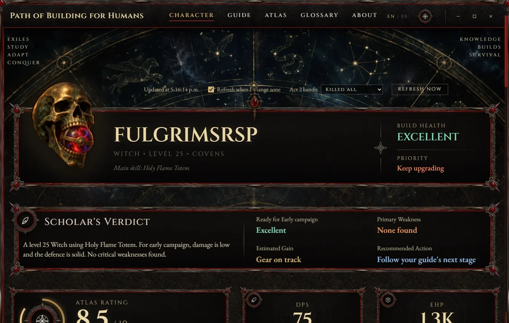
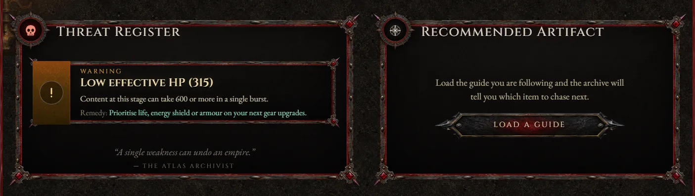
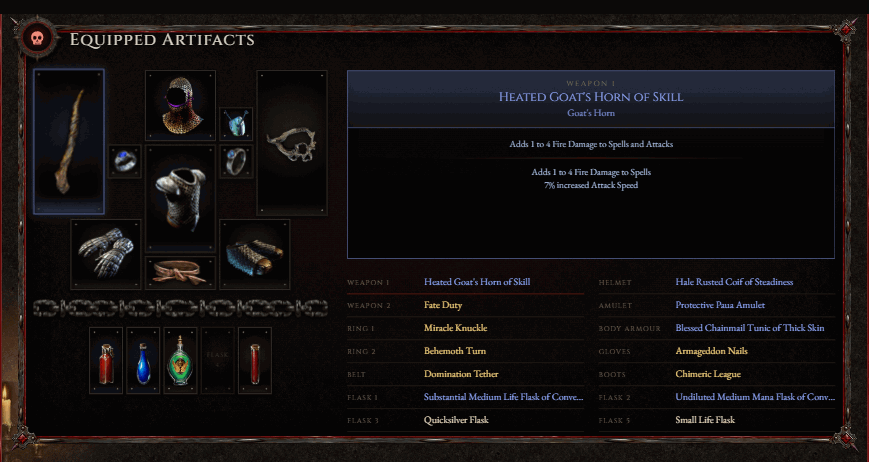
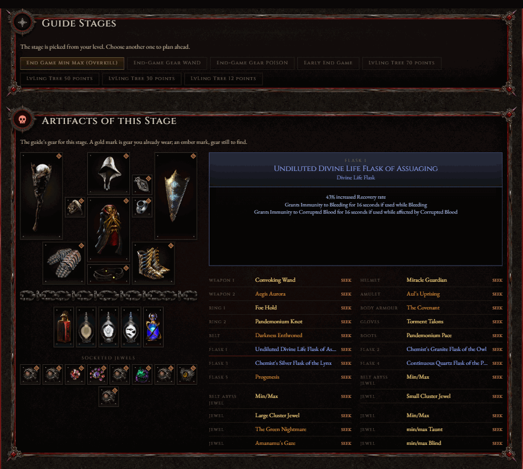
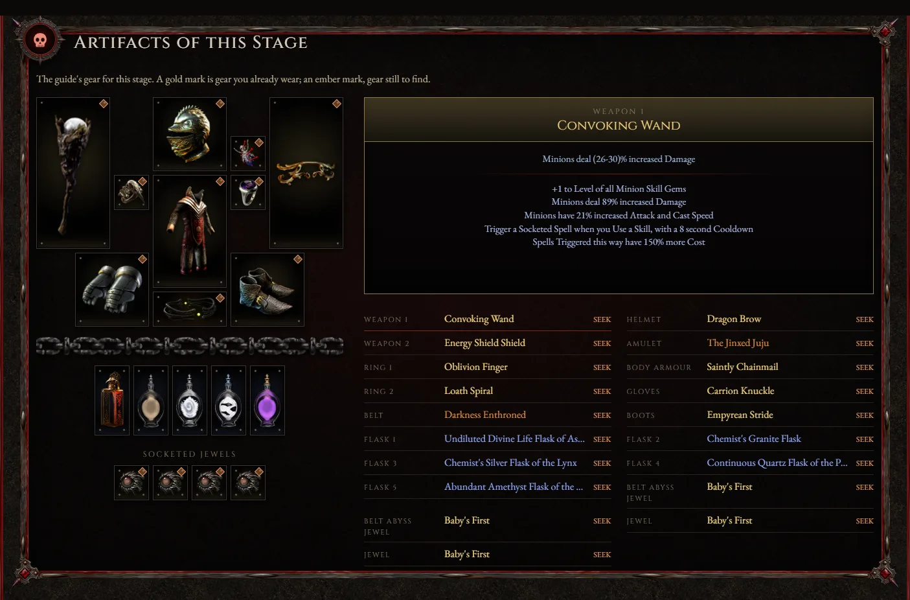
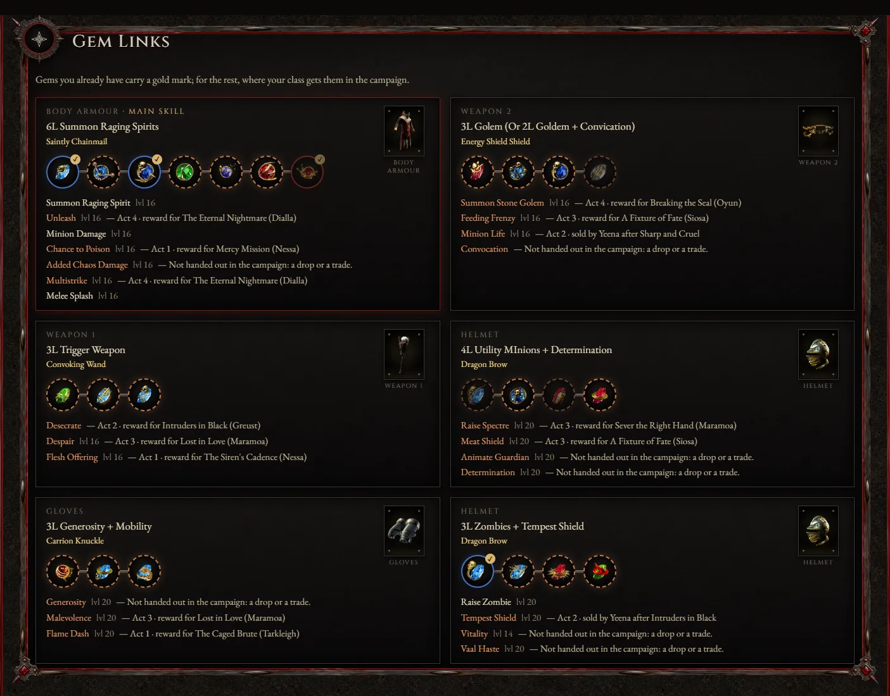
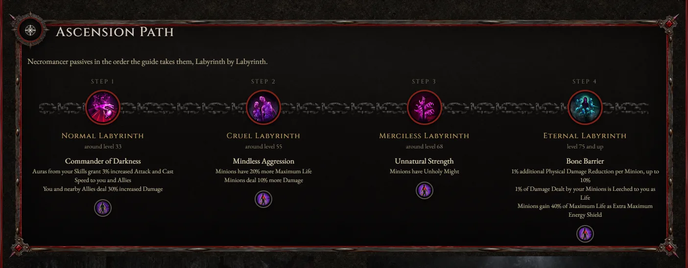
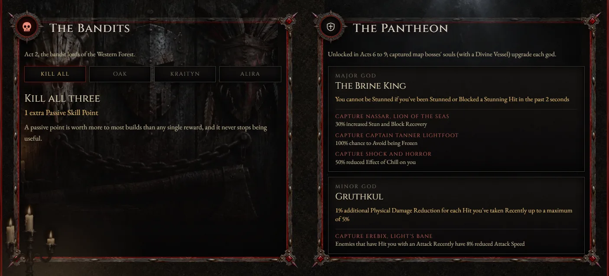
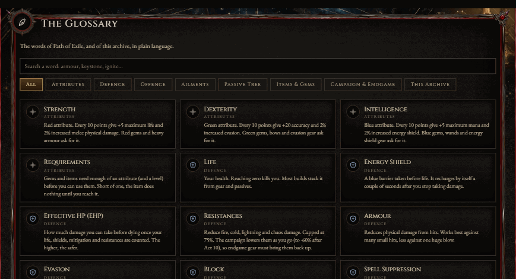

<p align="center">
  
</p>

<h1 align="center">Path of Building for Humans</h1>

<p align="center">
  <em>Same builds. A deeper understanding.</em>
</p>

<p align="center">
  A Path of Exile companion that turns Path of Building's numbers into answers,<br />
  and walks you through your guide while you play.
</p>

<p align="center">
  <a href="https://github.com/miguelhuerta-dev/PathOfBuildingForHumans/releases/latest"><strong>Download for Windows</strong></a>
  ·
  <a href="#español">Español</a>
  ·
  <a href="https://github.com/miguelhuerta-dev/PathOfBuildingForHumans/issues/new">Report a bug</a>
</p>

<p align="center">
  
</p>

---

## Why this exists

[Path of Building](https://pathofbuilding.community/) is an incredibly powerful tool. It tracks every damage
multiplier, every defensive layer and every interaction in a build, and the community could not theorycraft
without it.

But it speaks the language of spreadsheets. It tells you **what the numbers are**, not **what they mean** or
**what to do next**. A new or returning player can open a build and see hundreds of stats, and still not know:

- Is my build actually good?
- What is wrong with it?
- What should I do next, at the level I am now?

**Path of Building for Humans** runs the same Path of Building engine on your real character and answers in
plain words: a clear verdict, the problems that matter, the next upgrade worth chasing, and every step of the
guide you are following.

## What it does

### Your character, read at a glance

Connect your public pathofexile.com profile and pick a character. The archive calculates it with Path of
Building and refreshes it every time you change zone in the game.

- **Scholar's Verdict:** where your build stands and its main weakness, in one sentence.
- **Atlas Rating, DPS and EHP:** how ready the build is for its stage of the game.
- **Threat Register:** the problems found, worst first, with what each one costs you and how to fix it.
- **Recommended Artifact:** the guide item that would help you most, measured by Path of Building.



**Equipped Artifacts.** Your gear laid out like the in-game inventory; hover a piece to read it.



### Follow a guide, step by step

Paste a Path of Building code, a pobb.in or pastebin link. Guides with stages (levelling trees, early and late
gear, Maxroll-style) open on the stage that fits your character, and every stage you pick updates the whole page.
Your guides are kept in a library, and the last one opens by itself.



**Artifacts of this Stage.** The gear the stage asks for, with real icons (flasks and jewels too): a gold mark on
what you already wear, an ember mark on what is still to find. A levelling stage without gear of its own shows
the nearest stage's gear.



**Gem Links.** Every gem group as linked sockets. Gems you still lack say where your class gets them in the
campaign (act, quest and vendor), and each group shows the item it goes in: the one the guide names, or one
worked out from its links (6 links → body armour, 4 → helmet, gloves or boots).



**Passive Tree.** Your tree against the guide's, drawn as a constellation with each passive's own icon: taken in
gold, still to take in verdigris, and the closest notables, keystones and jewel sockets you are missing.


**Ascension Path, Bandits and Pantheon.** The ascendancy passives in the order to take them per Labyrinth, who to
help or kill in Act 2 and why, and the guide's pantheon powers.





### The Atlas

The Atlas passive tree over the star atlas. Follow a guide's official Atlas link, mark the passives you have and
see what comes next, kept per league.


### Glossary

Path of Exile's words, and the archive's own, explained plainly and searchable.



### The game's own art, never copied

Passive and Atlas icons, and the art of items without an official icon, are **read from your own Path of Exile
installation** (Steam or Epic), decoded and cached on your computer only. The app never ships nor downloads
Grinding Gear Games' art; item icons that do come from the web are the official ones from pathofexile.com.

## Download

1. Go to [Releases](https://github.com/miguelhuerta-dev/PathOfBuildingForHumans/releases/latest) and download
   `PathOfBuildingForHumans-vX.Y.Z-windows.exe`.
2. Run it. There is nothing to install: it is one file, for Windows 10 and 11.
3. Enter your account name (`Name#1234`), make sure your characters are public on pathofexile.com, and pick one.

Found a bug? [Open an issue](https://github.com/miguelhuerta-dev/PathOfBuildingForHumans/issues/new) with your
character, the guide and a screenshot.

## Features

| Feature | Since |
|---|---|
| Public pathofexile.com profile, character list, refresh on zone change (`Client.txt`) | v0.2.0 |
| Dashboard calculated by Path of Building: Atlas Rating, DPS, EHP, Verdict, Threat Register | v0.2.0 |
| Guides from PoB codes, pobb.in or pastebin, with stages; Recommended Artifact by measured gain | v0.2.0 |
| Passive tree and Atlas maps with the game's own icons | v0.3.0 |
| Single-file portable Windows app | v0.3.0 |
| Every guide stage updates gear, gems, tree and comparison; nearest-stage gear | v0.4.0 |
| Gem Links with sources (act, quest, vendor) and the item each group goes in | v0.4.0 |
| Ascension Path, Bandits and Pantheon | v0.4.0 |
| Guide library with the last guide restored | v0.4.0 |
| Glossary | v0.4.0 |
| Item art read from the installed game (magic flasks and more) | v0.4.0 |
| The Forge: what an item can roll and what each mod adds; unique sources and poe.ninja prices | v0.5.0 |
| Modifiers coloured by kind with tiers; Best Next Passives; progress over the league | v0.5.0 |
| English and Spanish, with a visual tour on first launch | v0.5.0 |
| League meta | Planned |
| Official OAuth account connection | Planned |

## Visual identity: the Atlas Archivist

The application is not a game UI, and it is not a SaaS dashboard. It is an **Atlas research tool**: an exiled
scholar studying character builds through ancient codices, celestial maps and recovered artifacts.

- Problems are presented as **threats**; solutions as **remedies**.
- Items are presented as **artifacts**; builds as **archived records**.
- Materials: black iron, dark vellum, worn steel and dried blood. No bright blues, plastic surfaces or neon.

The full guide lives in [`docs/visual_language.md`](docs/visual_language.md).

## Roadmap

- **v0.1** Atlas Archive UI, desktop app
- **v0.2.0** Live character, Path of Building engine, guides with stages, upgrade advisor
- **v0.3.0** Atlas and passive tree maps with the game's own icons, single-file portable app
- **v0.4.0** Guide tracking per stage: gear, gem links and sources, ascension, bandits, pantheon, glossary
- **v0.5.0** The Forge, modifiers by kind, Best Next Passives, progress, Spanish and a visual tour
- **Next** League meta and prices, official OAuth

See [`CHANGELOG.md`](CHANGELOG.md), [`docs/roadmap.md`](docs/roadmap.md) and the RFCs in [`rfc/`](rfc).

## For developers

Requirements: [Node.js](https://nodejs.org/) 22 or newer.

```bash
npm install
npm run dev
```

Then open http://localhost:5173. Tests: `npm test` (frontend) and `cargo test` in `src-tauri` (desktop).

### How the calculations work

Damage and defence numbers come from [Path of Building Community](https://github.com/PathOfBuildingCommunity/PathOfBuilding)
(MIT licence), run headless by `src-tauri/engine/pobh_engine.lua`; Path of Building itself is never modified.
Its version is pinned in `src-tauri/engine/engine.lock.json`; bump it each league. Diagnostic thresholds live in
`src/data/rules/poe1.json`, so patch changes are data edits, not code changes.

Where each gem is handed out in the campaign comes from [exile-leveling](https://github.com/HeartofPhos/exile-leveling)
(MIT licence), pinned in `scripts/update-gem-sources.mjs`.

### The passive and Atlas trees

Node positions, names and texts come from GGG's official exports, pinned per league:

| Tree | Source | Lock file | Regenerate |
|---|---|---|---|
| Character passives (Guide page) | [skilltree-export](https://github.com/grindinggear/skilltree-export) | `src/data/passives/passives.lock.json` | `node scripts/update-passive-tree.mjs` |
| Atlas (Atlas page) | [atlastree-export](https://github.com/grindinggear/atlastree-export) | `src/data/atlas/atlas.lock.json` | `node scripts/update-atlas-tree.mjs` |

Icons and item art are read from the player's installation (`src-tauri/src/game_files`: the game's bundles, its
`BaseItemTypes` and `ItemVisualIdentity` tables and DDS textures), cached per game version. Without the game the
maps keep their own marks. The standalone client (`Content.ggpk`) is not supported yet.

### Desktop app

The desktop app is built with [Tauri](https://tauri.app/). To run it locally you also need
[Rust](https://www.rust-lang.org/tools/install) and, once, the calculation engine. On Linux or macOS (needs git,
make and a C compiler):

```bash
scripts/setup-engine.sh
```

On Windows (needs git and Visual Studio with the **Desktop development with C++** workload):

```powershell
./scripts/setup-engine.ps1
```

Then:

```bash
npm run desktop:dev
```

**Debugging in Visual Studio (Windows):** `./scripts/debug-vs.ps1` starts the Vite dev server, builds the app in
debug mode and opens the executable in Visual Studio (F5 to run under the native debugger).

**Portable build (Windows):** `./scripts/build-portable.ps1` writes
`portable/PathOfBuildingForHumans.exe`, one file with the engine packed inside. Timeless and
abyss jewel tables (about 170 MB) are downloaded the first time a build needs one.

**Releases:** push a version tag such as `v0.4.0`. The **Desktop app (Windows portable)** workflow builds
`PathOfBuildingForHumans-v0.4.0-windows.exe` and `release-notes-v0.4.0.md` (that version's section of
`CHANGELOG.md`) as a 7-day artifact, then deletes the artifacts of earlier runs. Releases are published by hand
and never touched by the workflow.

## Project structure

```
src/                   React + TypeScript + Vite + Tailwind app
  analysis/            Diagnostic rules (the Threat Register)
  assets/atlas/        Original painted art, frames and textures (WebP)
  components/          Atlas frames, armoury, guide panels, shared controls
  data/                Diagnostic rules, glossary, passive and Atlas trees, gem sources
  guide/               Guide helpers (which item each gem group goes in)
  pages/               Character, Guide, Atlas, Glossary and About pages
  state/               Account, character, guide library and game art state
src-tauri/             Desktop app (Tauri, Rust): profiles, guides, Client.txt watcher, game files
  engine/              Path of Building bridge and pinned engine versions
scripts/               Engine setup, portable build, data updates, VS debugging
tests/                 Frontend tests (node --test)
docs/                  Vision, roadmap, competitor analysis, visual language, screenshots
rfc/                   Design proposals (MVP, dashboard, visual identity)
.github/workflows/     Windows portable build
```

## Licence and code signing

Published under the [MIT licence](LICENSE). Windows releases are signed through SignPath:
free code signing provided by [SignPath.io](https://about.signpath.io/), certificate by
[SignPath Foundation](https://signpath.org/). See the [code signing policy](CODE_SIGNING_POLICY.md),
which also says what the app connects to and when.

## Disclaimer

Path of Building for Humans is a fan-made project by [miguelhuerta-dev](https://github.com/miguelhuerta-dev). It
is not affiliated with or endorsed by Grinding Gear Games or the Path of Building Community. Path of Exile is a
trademark of Grinding Gear Games.

---

<h2 id="español">Español</h2>

<p align="center">
  <em>Las mismas builds. Una comprensión más profunda.</em>
</p>

Un compañero para Path of Exile que convierte los números de Path of Building en respuestas y te guía paso a
paso por tu guía mientras juegas.

**[Descargar para Windows](https://github.com/miguelhuerta-dev/PathOfBuildingForHumans/releases/latest)** ·
**[Reportar un error](https://github.com/miguelhuerta-dev/PathOfBuildingForHumans/issues/new)**

### Por qué existe

[Path of Building](https://pathofbuilding.community/) es una herramienta increíblemente potente: calcula cada
multiplicador de daño, cada capa defensiva y cada interacción de una build. La comunidad no podría teorizar sin
ella.

Pero habla el idioma de las hojas de cálculo. Te dice **cuáles son los números**, no **qué significan** ni
**qué hacer después**. Un jugador nuevo o que vuelve abre una build, ve cientos de estadísticas y sigue sin
saber:

- ¿Mi build es buena de verdad?
- ¿Qué le pasa?
- ¿Qué hago ahora, en el nivel en el que estoy?

**Path of Building for Humans** usa el mismo motor de Path of Building sobre tu personaje real y responde con
palabras claras: un veredicto, los problemas que importan, la siguiente mejora que vale la pena y cada paso de la
guía que sigues.

### Qué hace

**Tu personaje, de un vistazo.** Conecta tu perfil público de pathofexile.com y elige un personaje. El archivo
lo calcula con Path of Building y se actualiza cada vez que cambias de zona en el juego.

- **Scholar's Verdict:** cómo está tu build y su debilidad principal, en una frase.
- **Atlas Rating, DPS y EHP:** qué tan lista está la build para su etapa del juego.
- **Threat Register:** los problemas encontrados, del peor al menor, con lo que te cuestan y cómo arreglarlos.
- **Recommended Artifact:** el item de la guía que más te ayudaría, medido por Path of Building.
- **Equipped Artifacts:** tu equipo como en el inventario del juego; pasa el mouse por una pieza para leerla.

**Sigue una guía paso a paso.** Pega un código de Path of Building o un enlace de pobb.in o pastebin. Las guías
con stages (árboles de leveo, equipo temprano y final, al estilo Maxroll) abren en el stage que corresponde a tu
personaje, y cada stage que eliges actualiza toda la página. Tus guías se guardan en una biblioteca y la última
se abre sola.

- **Artifacts of this Stage:** el equipo que pide el stage, con sus iconos reales (también frascos y jewels).
  Marca dorada en lo que ya llevas y marca roja en lo que te falta. Si un stage de leveo no tiene equipo propio,
  se muestra el del stage más cercano.
- **Gem Links:** cada grupo de gemas como sockets enlazados. Las gemas que te faltan dicen dónde las da tu clase
  en la campaña (acto, quest y vendedor), y cada grupo muestra el item donde va: el que nombra la guía o uno
  calculado por sus links (6 links → pecho, 4 → casco, guantes o botas).
- **Passive Tree:** tu árbol contra el de la guía, dibujado como una constelación con el icono de cada pasiva:
  lo que ya tienes en dorado, lo que falta en verde, y los notables, keystones y sockets de jewel más cercanos.
- **Ascension Path, Bandits y Pantheon:** las pasivas de ascendancy en orden por cada Labyrinth, a quién ayudar o
  matar en el Acto 2 y por qué, y los poderes del pantheon de la guía.

**El Atlas.** El árbol de pasivas del Atlas sobre el mapa estelar. Sigue el enlace oficial del Atlas de una
guía, marca las pasivas que tienes y mira qué sigue, guardado por liga.

**Glosario.** Los términos de Path of Exile y de la app, explicados de forma sencilla y con buscador.

**El arte del juego, nunca copiado.** Los iconos de las pasivas y del Atlas, y el arte de los items sin icono
oficial, **se leen de tu propia instalación de Path of Exile** (Steam o Epic) y se guardan solo en tu
computadora. La app nunca incluye ni descarga el arte de Grinding Gear Games; los iconos de items que vienen de
internet son los oficiales de pathofexile.com.

Las capturas de arriba muestran cada una de estas secciones.

### Descarga

1. Entra en [Releases](https://github.com/miguelhuerta-dev/PathOfBuildingForHumans/releases/latest) y descarga
   `PathOfBuildingForHumans-vX.Y.Z-windows.exe`.
2. Ábrelo. No hay nada que instalar: es un solo archivo, para Windows 10 y 11.
3. Escribe tu nombre de cuenta (`Nombre#1234`), asegúrate de que tus personajes sean públicos en
   pathofexile.com y elige uno.

¿Encontraste un error? [Abre un issue](https://github.com/miguelhuerta-dev/PathOfBuildingForHumans/issues/new)
con tu personaje, la guía y una captura.

### Funciones

| Función | Desde |
|---|---|
| Perfil público de pathofexile.com, lista de personajes, actualización al cambiar de zona (`Client.txt`) | v0.2.0 |
| Dashboard calculado por Path of Building: Atlas Rating, DPS, EHP, Verdict, Threat Register | v0.2.0 |
| Guías desde códigos de PoB, pobb.in o pastebin, con stages; Recommended Artifact por ganancia medida | v0.2.0 |
| Mapas del árbol de pasivas y del Atlas con los iconos del propio juego | v0.3.0 |
| App portable de Windows en un solo archivo | v0.3.0 |
| Cada stage de la guía actualiza equipo, gemas, árbol y comparación; equipo del stage más cercano | v0.4.0 |
| Gem Links con su origen (acto, quest, vendedor) y el item donde va cada grupo | v0.4.0 |
| Ascension Path, Bandits y Pantheon | v0.4.0 |
| Biblioteca de guías, con la última guía restaurada | v0.4.0 |
| Glosario | v0.4.0 |
| Arte de items leído del juego instalado (frascos mágicos y más) | v0.4.0 |
| Meta de la liga y precios (poe.ninja) | Planeado |
| Conexión oficial de cuenta con OAuth | Planeado |

### Identidad visual: el Archivista del Atlas

La app no es una interfaz de juego ni un dashboard corporativo. Es una **herramienta de investigación del
Atlas**: un erudito exiliado que estudia builds a través de códices antiguos, mapas celestes y artefactos
recuperados. Los problemas son **amenazas** y las soluciones **remedios**; los items son **artefactos** y las
builds **registros archivados**. Materiales: hierro negro, pergamino oscuro, acero gastado y sangre seca.

### Para desarrolladores

Necesitas [Node.js](https://nodejs.org/) 22 o superior:

```bash
npm install
npm run dev
```

Y abre http://localhost:5173. Pruebas: `npm test` (frontend) y `cargo test` en `src-tauri` (escritorio).

- **Cálculos:** vienen de [Path of Building Community](https://github.com/PathOfBuildingCommunity/PathOfBuilding)
  (licencia MIT), ejecutado sin interfaz por `src-tauri/engine/pobh_engine.lua`, sin modificar Path of Building.
  Su versión está fijada en `src-tauri/engine/engine.lock.json`.
- **Origen de las gemas:** de [exile-leveling](https://github.com/HeartofPhos/exile-leveling) (licencia MIT).
- **Árboles:** posiciones y textos de los exports oficiales de GGG, fijados por liga (tabla de la sección en
  inglés).
- **App de escritorio:** hecha con [Tauri](https://tauri.app/). Además necesitas
  [Rust](https://www.rust-lang.org/tools/install) y preparar el motor una vez con `scripts/setup-engine.sh`
  (Linux/macOS) o `./scripts/setup-engine.ps1` (Windows, con Visual Studio y **Desktop development with C++**).
  Luego `npm run desktop:dev`.
- **Build portable:** `./scripts/build-portable.ps1` genera un solo `.exe` con el motor dentro.
- **Versiones:** al subir un tag como `v0.4.0`, GitHub Actions compila el `.exe` y sus notas como artifact de
  7 días y borra los artifacts anteriores. La Release se publica a mano.

### Licencia y firma de código

Publicado bajo la [licencia MIT](LICENSE). Las versiones para Windows se firman con SignPath:
firma de código gratuita de [SignPath.io](https://about.signpath.io/), certificado de
[SignPath Foundation](https://signpath.org/). Consulta la [política de firma](CODE_SIGNING_POLICY.md),
que también explica a qué se conecta la app y cuándo.

### Aviso

Path of Building for Humans es un proyecto hecho por fans, creado por
[miguelhuerta-dev](https://github.com/miguelhuerta-dev). No está afiliado ni respaldado por Grinding Gear Games
ni por Path of Building Community. Path of Exile es una marca registrada de Grinding Gear Games.
